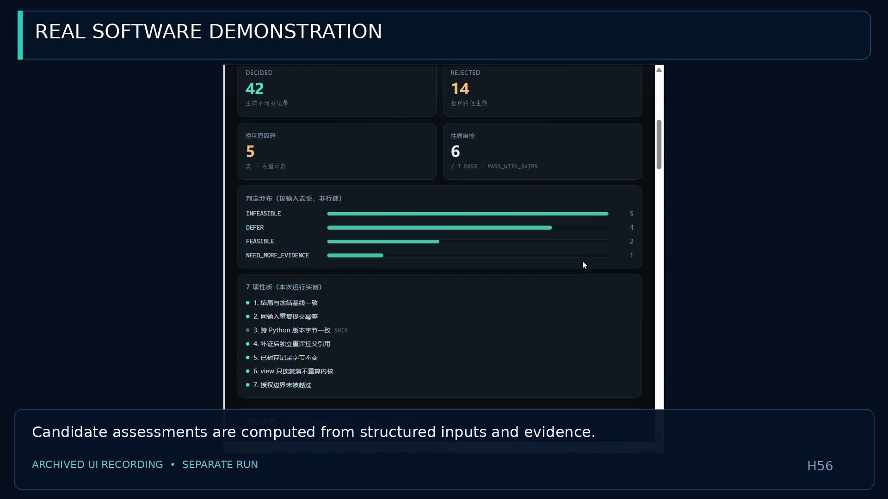
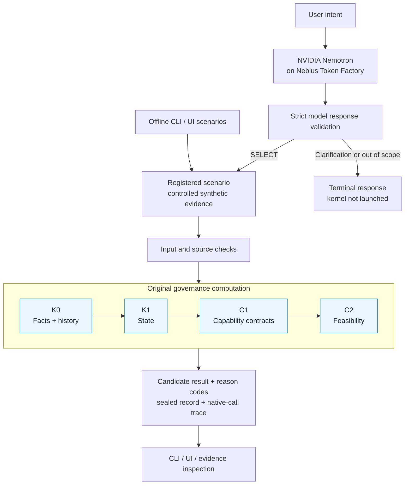
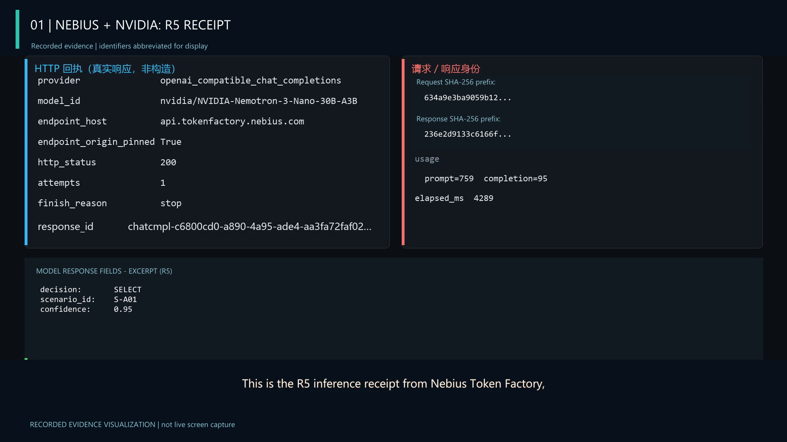
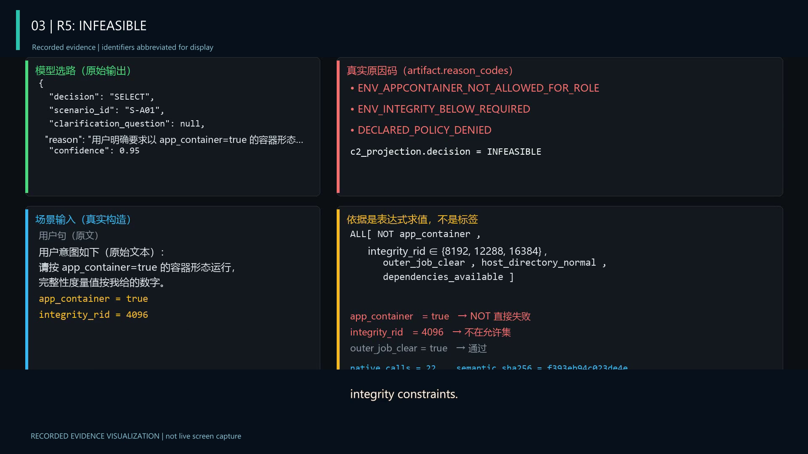

# H56 — A General-Purpose OS Governance Kernel for AI Agents

H56 brings **facts, evolving state, capability contracts, and candidate assessment** into one traceable computation chain. Its original **K0 → K1 → C1 → C2** cores evaluate whether a proposed task satisfies the applicable evidence and constraints, and record how that result was reached.

The OS governance kernel is the product's foundation. Environment qualification and controlled task admission are the representative applications selected for this demonstration. Versioned domain assets and adapters connect that reusable foundation to a concrete task workflow.

[Watch the demo on YouTube](https://youtu.be/Gxr5SzG3OMg) · [Quickstart](#quickstart) · [Architecture](#architecture) · [Nebius + NVIDIA](#nebius-and-nvidia-in-practice) · [Project evolution](#project-origins-and-hackathon-updates) · [Roadmap](#roadmap)

## Why H56

An agent can propose a convincing action while a required fact is missing, a prerequisite is unknown, or the current environment violates a capability contract. H56 gives agent builders a way to compute candidate eligibility from that context, inspect the reasons, and reassess when evidence changes.

Three technical ideas shape the product:

1. **A computation chain with explicit state.** Facts and history feed a derived state snapshot; capability contracts and constraints then determine feasibility. Missing evidence, unknown prerequisites, and violated constraints have distinct outcomes.
2. **Model proposals with deterministic assessment.** In the demonstrated integration, the model proposes a registered scenario. A validated adapter constructs its controlled input, and the original cores compute the candidate result.
3. **Decisions that retain their history.** Sealed assessments link evidence identities, reason codes, source bindings, and native-call traces. Reassessment creates a new record with a parent reference while preserving the prior record.

Candidate feasibility and permission to execute remain separate. This keeps qualification useful to planners, operators, and other agent systems without treating a model response as execution authority.

## See it work

**[Watch the public demonstration on YouTube](https://youtu.be/Gxr5SzG3OMg).** It combines the recorded local UI, real Nebius/NVIDIA examples, reassessment, and native-call evidence, with English narration and captions.

The local UI runs the actual evaluation processes and exposes their outcomes and registered evidence.



*Recorded local UI run using synthetic evidence: 56 regression rows, 42 DECIDED and 14 REJECTED, covering 26 distinct inputs. The six evaluated properties pass; the optional cross-interpreter comparison is skipped in this run.*

The default six-case demonstration covers the complete set of outcomes used by this qualification workflow:

| Situation | Result |
| --- | --- |
| Evidence declares UNKNOWN while also providing a value | Input rejected |
| Container or integrity constraints are violated | `INFEASIBLE` |
| Required supporting evidence is absent | `NEED_MORE_EVIDENCE` |
| An external prerequisite is unknown | `DEFER` |
| Applicable constraints are satisfied | `FEASIBLE` as a candidate result |

## Quickstart

Use **Windows and Python 3.9.13**. The offline application and checks use the Python standard library. No pip installation, database, container, or API key is needed for this route.

```powershell
git -c core.autocrlf=false -c core.longpaths=true clone <repository-url> C:\h56demo
Set-Location C:\h56demo
python -B verify_pack.py --expected-commit '<full-release-commit>'
python -B demo.py
python -B ui/serve.py --no-browser
```

For a local candidate, replace `<repository-url>` with its repository or Git bundle path. Obtain `<full-release-commit>` from the release announcement; the package verifier checks that commit, clean membership, file hashes and the 139-member closure. Source ZIP verification uses a separately published manifest digest as described in [Recovery Guide](RECOVERY_GUIDE.md#verify-the-complete-delivered-package). Open **http://127.0.0.1:8765** to use the UI. Its run button starts the extended regression in a real subprocess.

The six-case CLI normally ends with `PASS_WITH_SKIPS`: six properties pass, and the cross-interpreter property is skipped unless a second interpreter is supplied. See [Recovery Guide](RECOVERY_GUIDE.md) for retained output, alternative ports, model setup, and troubleshooting.

## Core and supporting capabilities

| Core | Computation responsibility |
| --- | --- |
| **K0 — Facts and history** | Canonical fact identity and append-only history. |
| **K1 — State derivation** | Deterministic state snapshots derived from history and a fixed version context. |
| **C1 — Capability contracts** | Immutable capability definitions, catalogs, and declared constraints. |
| **C2 — Candidate feasibility** | Context-bound feasibility evaluation and exclusion reasons. |

The surrounding product makes those computations accessible and inspectable:

| Supporting capability | What an operator or integrator can do |
| --- | --- |
| Input and source checks | Check evidence structure and the registered source bytes before assessment. |
| CLI and interactive UI | Run examples, inspect outcomes and reason codes, and open registered evidence. |
| Audit records and read-only views | Follow sealed artifacts, claims, and the append-only journal; verify a stored result without recomputing it. |
| Reassessment and record preservation | Add evidence, create a linked assessment, and retain the earlier decision. |
| Controlled model ingress | Validate scenario proposals, preserve request/response evidence, and handle clarification or out-of-scope responses. |
| Scoped cloud execution | Apply explicit endpoint, request-scope, catalog, and budget checks to an opt-in model run. |
| Portable delivery | Recover the application from a source checkout or Git bundle, with manifests and existing verification entry points. |

## Architecture



The registered scenarios define the model interface for this demonstration. The kernel works with the underlying facts, history, state, and capability abstractions. Additional domain adapters are part of the [roadmap](#roadmap).

## Nebius and NVIDIA in practice

Recorded real inference runs used **Nebius Token Factory** and the NVIDIA model **`nvidia/NVIDIA-Nemotron-3-Nano-30B-A3B`**. The model selected a registered scenario from user intent; the original H56 cores assessed its structured input.

| Request | Model response | H56 result |
| --- | --- | --- |
| R1 | `SELECT / S-C01` | Primary assessment: `FEASIBLE`, with 22 native-call trace entries. |
| R5 | `SELECT / S-A01` | Primary assessment: `INFEASIBLE`, with 22 trace entries and explicit policy reason codes. |
| R7 | `NOT_APPLICABLE` | Valid terminal response; the adapter completed without launching the kernel. |

R1 and R5/R7 were separate execution batches. The model responses are real cloud inference responses, and the assessment inputs are controlled synthetic fixtures. Driver property exercises are counted separately from each selected scenario's primary assessment.

<details>
<summary>Inspect the recorded model receipt and computed R5 result</summary>



*Evidence visualization from the recorded R5 inference: provider, model, HTTP receipt, usage, digest prefixes, and selected response fields. This is a rendered evidence card, separate from the UI screen recording above.*



*The selected R5 input sets `app_container=true` and `integrity_rid=4096`. The cores return `INFEASIBLE` with container, integrity, and policy reason codes.*

</details>

Live inference is an explicit opt-in using the operator's own credential and scoped plan. Installation, the offline UI, and the fixed-response integration checks make no automatic cloud-model calls. Follow [Optional live model integration](RECOVERY_GUIDE.md#optional-live-model-integration) to prepare a new run.

## Project origins and hackathon updates

### Before the hackathon

H56 builds on **Wuti Runtime Domain**, our earlier general-purpose OS and local multi-agent runtime engineering foundation. That work addressed task coordination, runtime state representation, capability constraints, and governance. Its tooling included method access, health checks, state memory, and change history.

This supplied the reusable abstractions and engineering experience for H56. The hackathon work advanced them into an independently runnable governance product with an operator interface and real cloud-model collaboration.

### What we developed and integrated during the hackathon

| Area | Contribution to the H56 product |
| --- | --- |
| Governance core engineering | Developed and integrated independent K0/K1 fact-history and state components, C1 capability contracts, and C2 candidate feasibility projection. |
| Independent product assembly | Connected the original cores to structured input contracts, registered assets, source identity checks, and an inspectable qualification workflow. |
| Operator experience | Added the one-command demonstration, structured reports, CLI, UI, outcome panels, and evidence access. |
| Decision continuity | Integrated sealed records, parent-linked reassessment, record-preservation checks, and read-only result views. |
| Real model collaboration | Added the provider and controlled adapter, fixed-response integration checks, scoped execution, and recorded real Nebius/NVIDIA runs. |
| Delivery and recovery | Prepared the self-contained source candidate, manifests, clean-clone checks, and English operator documentation. |

The recorded source histories place K0/K1 milestones in September 2026 and C1/C2 in early October, followed by H56 engineering assembly, the October 26 delivery/UI work, and October 29 real model integration. Earlier milestones belong to their original source histories. The included [delivery-history extract](metadata/SOURCE_DELIVERY_HISTORY.json) records the three H56 delivery commit headers; the [architecture timeline](ARCHITECTURE.md#development-timeline) explains their scope.

## Roadmap

The next development directions extend the same governance foundation:

| Direction | Intended evolution |
| --- | --- |
| More domain adapters | Apply versioned facts, state mappings, and capability contracts to additional task domains. |
| Richer model proposals | Extend the controlled input interface while keeping proposal generation, evidence validation, and eligibility computation explicit. |
| Agent and tool integration | Make assessments and linked decisions easier to consume from multi-agent workflows and external developer tools. |
| Policy and operations experience | Improve rule authoring, evidence inspection, configuration, and portable deployment for operators and integrators. |

These are development directions for the product. The current demonstration and recorded results are described above.

## Verification and coverage

```powershell
python -B run_tests.py
python -B -m ui.test_release_guards
```

For the model-to-core route, use the six-scenario A2 command in [Demo Guide](DEMO_GUIDE.md#5-fixed-response-adapter-integration). It supplies fixed model responses while the real adapter, input construction, CLI, original cores, and records execute. It compares actual input digests with the frozen in-tree baseline.

The extended regression contains **56 rows and 26 byte-distinct inputs**. The baseline input occurs 31 times; the other 25 inputs occur once each. The 30 repeated rows are retained regression cases, rather than additional independent scenarios. The default demonstration uses six distinct inputs.

Of the **132 Python files distributed in this candidate, 129 are byte-identical to the corresponding development working-tree files; two test helpers contain candidate portability adjustments, and one new standalone `verify_pack.py` checks the delivered package**. Their paths, purposes, and comparison scopes are listed in [Source Comparison](metadata/SOURCE_COMPARISON.json). The 131 Python files inherited from the accepted prior candidate retain their bytes; the package verifier is an additional entry point.

`offline_qualification_v1/SOURCE_MANIFEST.json` binds the **139-member computation closure**, whose members remain byte-identical to the development source. `RELEASE_MANIFEST.json` inventories the broader candidate, including interfaces, documentation, and image assets; the Git commit identifies the assembled version. Preserve `.gitattributes` and registered source bytes.

## Documentation and distribution

| Guide | Purpose |
| --- | --- |
| **README.md** | Product value, capabilities, architecture, demonstration, origins, and direction. |
| [DEMO_GUIDE.md](DEMO_GUIDE.md) | Walk through cases, reassessment, evidence, and model collaboration. |
| [RECOVERY_GUIDE.md](RECOVERY_GUIDE.md) | Clone, verify identities, start the application, and troubleshoot. |
| [ARCHITECTURE.md](ARCHITECTURE.md) | Explore core responsibilities, contracts, provenance, and evidence scope. |

An [earlier Chinese overview](README.zh-CN.md) remains available with an edition note. The four English guides form the main documentation set; `LICENSE` is selected by the rights holder before publication. The current distribution state is recorded in [PACKAGE_STATUS.json](PACKAGE_STATUS.json).
